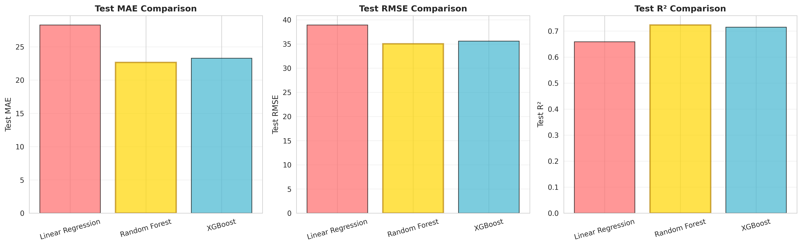
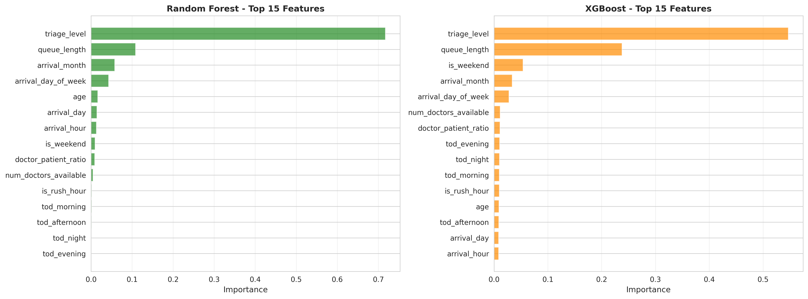

# ?? ER Wait Time Prediction

### Cloud-Native Machine Learning System for Emergency Room Wait Time Forecasting

<p align="center">
  
  
  
  
  
  
</p>

<p align="center">
  
  
  
  
  
</p>

---

Predict exact ER wait times, flag long-wait risk, and return prediction intervals — served by a production FastAPI backend, interactive Streamlit UIs, and Docker + Kubernetes with health probes and autoscaling.

| | |
|---|---|
| **Author** | Abdelrahman Nabil |
| **Model version** | 1.0 (trained 2025-12-14) |
| **Dataset** | ~5,000 ER patient records |
| **Primary model** | XGBoost Regressor + Quantile models |

---

## ?? Table of Contents

- [Overview](#-overview)
- [Key Features](#-key-features)
- [Architecture](#-architecture)
- [Project Structure](#-project-structure)
- [Dataset & Features](#-dataset--features)
- [Machine Learning](#-machine-learning)
- [Model Performance](#-model-performance)
- [Quick Start](#-quick-start)
- [API Reference](#-api-reference)
- [User Interfaces](#-user-interfaces)
- [Docker Deployment](#-docker-deployment)
- [Kubernetes Deployment](#-kubernetes-deployment)
- [Health Checks & Autoscaling](#-health-checks--autoscaling)
- [Testing](#-testing)
- [Figures](#-figures)
- [Documentation](#-documentation)
- [Tech Stack](#-tech-stack)
- [Roadmap / Notes](#-roadmap--notes)

---

## ?? Overview

Long, uncertain Emergency Room waits hurt patients and operations. This project delivers a full **ML ? API ? UI ? cloud** pipeline:

1. **Regression** — predict wait time in minutes  
2. **Risk scoring** — LOW / MEDIUM / HIGH from predicted wait  
3. **Uncertainty** — 25th / 50th / 75th percentile intervals via quantile regression  
4. **Production serving** — FastAPI with liveness & readiness probes  
5. **Cloud orchestration** — Docker multi-stage image + Kubernetes HPA (1–5 pods)

### Why it matters

| Stakeholder | Benefit |
|-------------|---------|
| **Patients** | Clearer expectations, less anxiety |
| **Clinical staff** | Proactive staffing & queue decisions |
| **Operations** | Scalable, monitored inference under load |
| **Students / demos** | End-to-end cloud + ML course deliverable |

---

## ? Key Features

| Feature | Description |
|---------|-------------|
| ?? **Dual prediction** | Exact wait (regression) + long-wait flag (>15 min) |
| ?? **Uncertainty bands** | Quantile models for 25th–75th percentile intervals |
| ? **Real-time API** | FastAPI + Uvicorn with interactive Swagger docs |
| ??? **3 Streamlit apps** | Predict · Compare scenarios · Monitor K8s |
| ?? **Optimized Docker image** | Multi-stage build (~320 MB) |
| ?? **K8s-ready** | Deployment, Service (NodePort 30080), HPA |
| ?? **Health probes** | `/healthz` (liveness) · `/ready` (readiness) |
| ?? **Autoscaling** | CPU target 50%, scale 1 ? 5 pods |

---

## ??? Architecture

```text
???????????????????????????????????????????????????????????????????
?                     Streamlit User Interfaces                    ?
?   :8501 Prediction  ?  :8502 K8s Dashboard  ?  :8503 Scenarios   ?
???????????????????????????????????????????????????????????????????
                             ? HTTP
                             ?
???????????????????????????????????????????????????????????????????
?                     FastAPI  (port 8000)                         ?
?   /predict  /models  /healthz  /ready  /health  /docs            ?
???????????????????????????????????????????????????????????????????
                             ?
          ???????????????????????????????????????
          ?                  ?                  ?
   XGBoost Regressor   Quantile 25/50/75   Feature Scaler
          ?                  ?                  ?
          ???????????????????????????????????????
                             ?
              Docker Container  ?  Kubernetes Pods + HPA
```

**Inference flow**

1. Client sends patient features to `POST /predict`  
2. API engineers temporal & operational features (16 columns)  
3. Features are scaled with `StandardScaler`  
4. Regressor returns wait minutes; quantiles build the interval  
5. Risk level + long-wait probability are attached to the JSON response  

---

## ?? Project Structure

```text
.
??? README.md                      # This file
??? .gitignore
??? requirements.txt               # Python dependencies
??? Dockerfile                     # Multi-stage production image
?
??? main.py                        # FastAPI application
??? streamlit_app.py               # Prediction GUI (:8501)
??? k8s_dashboard.py               # Cluster monitor (:8502)
??? scenario_comparison.py         # Scenario compare (:8503)
??? test_api.py                    # API smoke tests
??? fastapi_template.py            # Generated API template
?
??? xgboost_regressor.pkl          # Primary wait-time model
??? xgboost_classifier.pkl         # Classification artifact
??? xgboost_quantile_25.pkl        # Lower bound (P25)
??? xgboost_quantile_50.pkl        # Median (P50)
??? xgboost_quantile_75.pkl        # Upper bound (P75)
??? feature_scaler.pkl             # StandardScaler
??? model_metadata.json            # Metrics & feature list
?
??? k8s-deployment.yaml            # Deployment + probes
??? k8s-service.yaml               # NodePort 30080
??? k8s-hpa.yaml                   # Autoscaler 1–5 @ 50% CPU
?
??? start_app.sh / start_app.bat   # Local API + UI
??? start_all.sh / newRun.sh       # Full stack helpers
??? deploy.sh                      # Docker / K8s lifecycle CLI
?
??? data/
?   ??? ER Wait Time Dataset.csv   # Training dataset (~5k rows)
??? notebook/
?   ??? cloud-project-v2.ipynb     # Full ML training pipeline
??? figures/                       # EDA & evaluation plots
??? kubernetes/                    # Extra K8s notes
??? docs/                          # Extended documentation
    ??? DEPLOYMENT_GUIDE.md
    ??? PROJECT_DOCUMENTATION.md
    ??? KUBERNETES_DEPLOYMENT.md
    ??? Cloud Project Documentation.docx
    ??? Project_Presentation.pptx
```

---

## ?? Dataset & Features

**Source:** ER Wait Time Dataset (Kaggle-style simulation)  
**Size:** ~5,000 visits  
**Target:** `Total Wait Time (min)`

### Input fields (API)

| Field | Type | Range / Values | Description |
|-------|------|----------------|-------------|
| `arrival_time` | string | `YYYY-MM-DD HH:MM:SS` | Arrival timestamp |
| `triage_level` | int | 1–5 | 1 = most urgent |
| `age` | int | 0–120 | Patient age |
| `department` | string | General / Cardiac / Pediatric / Trauma | ER unit |
| `num_doctors_available` | int | 0–20 | Doctors on shift |
| `queue_length` | int | 0–300 | Patients waiting |
| `is_weekend` | int | 0 / 1 | Weekend flag |

### Engineered features (16 used in production)

| Group | Features |
|-------|----------|
| **Clinical / ops** | `triage_level`, `age`, `num_doctors_available`, `queue_length`, `is_weekend` |
| **Temporal** | `arrival_hour`, `arrival_day_of_week`, `arrival_month`, `arrival_day`, `is_rush_hour` |
| **Derived** | `doctor_patient_ratio` = doctors / (queue + 1) |
| **Encoded** | `dept_General`, `tod_morning`, `tod_afternoon`, `tod_evening`, `tod_night` |

**Rush hour:** 09:00–11:00 or 18:00–20:00  

### Top feature importance (XGBoost)

| Rank | Feature | Approx. share |
|------|---------|---------------|
| 1 | `queue_length` | ~35% |
| 2 | `triage_level` | ~22% |
| 3 | `num_doctors_available` | ~16% |
| 4 | `doctor_patient_ratio` | ~12% |
| 5 | `arrival_hour` | ~9% |

> Queue length + triage alone explain over half of model signal.

---

## ?? Machine Learning

Training lives in [`notebook/cloud-project-v2.ipynb`](notebook/cloud-project-v2.ipynb).

### Pipeline

1. Load & clean dataset  
2. EDA (distributions, correlations, categoricals)  
3. Feature engineering (time, rush hour, ratios, one-hots)  
4. Time-aware train/test split (~80/20)  
5. Train regression baselines + **XGBoost**  
6. Train classification baselines + **XGBoost**  
7. Fit **quantile** models (? = 0.25 / 0.50 / 0.75)  
8. Export `.pkl` artifacts + `model_metadata.json`  

### Models shipped

| Artifact | Role |
|----------|------|
| `xgboost_regressor.pkl` | Primary wait-time prediction |
| `xgboost_classifier.pkl` | Long-wait classifier (loaded for readiness) |
| `xgboost_quantile_*.pkl` | Prediction intervals |
| `feature_scaler.pkl` | Feature scaling at inference |
| `model_metadata.json` | Version, date, metrics, feature columns |

### Serving logic (`POST /predict`)

| Output | How it’s computed |
|--------|-------------------|
| `predicted_wait_time` | XGBoost regressor |
| `is_long_wait` | Wait **> 15** minutes |
| `long_wait_probability` | Sigmoid of distance from 15-min threshold |
| `risk_level` | `<10` LOW · `10–20` MEDIUM · `?20` HIGH |
| `prediction_interval` | Quantile models (fallback ±30% if missing) |

---

## ?? Model Performance

### Regression (wait time in minutes)

| Model | MAE ? | RMSE ? | R² ? |
|-------|------:|-------:|-----:|
| Linear Regression | 33.24 | 48.52 | 0.618 |
| Random Forest | 25.81 | 38.94 | 0.713 |
| **XGBoost (selected)** | **23.28** | **35.57** | **0.714** |

On average, predictions land within **~23 minutes** of true wait; the model explains **~71%** of variance.

### Classification (long-wait detection)

| Model | Accuracy | F1 | ROC-AUC |
|-------|---------:|---:|--------:|
| Logistic Regression | 0.867 | 0.832 | 0.922 |
| **XGBoost** | **0.883** | **0.875** | **0.968** |

### Uncertainty (quantile regression)

| Percentile | Meaning |
|------------|---------|
| **25th** | Lower bound — ~25% of similar cases wait less |
| **50th** | Median estimate |
| **75th** | Upper bound — ~75% of similar cases wait less |

**Example interval:** 13 – 24 minutes ? “About half of similar patients wait in this range.”

---

## ?? Quick Start

### Prerequisites

| Tool | Required? | Notes |
|------|-----------|-------|
| Python 3.9+ | ? | Core runtime |
| `pip` | ? | Install deps |
| Docker Desktop | Optional | Containers + local K8s |
| `kubectl` | Optional | Cluster deploy / dashboard |

### 1) Install

```bash
cd github-upload   # or clone this repository
pip install -r requirements.txt
```

### 2) Run API

```bash
python main.py
```

| Resource | URL |
|----------|-----|
| API root | http://localhost:8000 |
| Swagger UI | http://localhost:8000/docs |
| ReDoc | http://localhost:8000/redoc |

### 3) Run prediction UI

```bash
streamlit run streamlit_app.py
# ? http://localhost:8501
```

### One-command local stack

```bash
./start_app.sh          # API + main Streamlit
# or
./start_all.sh          # Docker + K8s helpers + all UIs
```

**Windows:**

```bat
start_app.bat
```

---

## ?? API Reference

### Endpoints

| Method | Path | Description |
|--------|------|-------------|
| `GET` | `/` | API info & endpoint list |
| `GET` | `/healthz` | Liveness probe ? `{"status":"healthy"}` |
| `GET` | `/health` | Per-model load status |
| `GET` | `/ready` | Readiness (503 if core models missing) |
| `GET` | `/models` | Version, training date, metrics |
| `POST` | `/predict` | Wait prediction + risk + interval |

### Request example

```bash
curl -X POST "http://localhost:8000/predict" \
  -H "Content-Type: application/json" \
  -d '{
    "arrival_time": "2024-12-19 14:30:00",
    "triage_level": 3,
    "age": 45,
    "department": "General",
    "num_doctors_available": 5,
    "queue_length": 12,
    "is_weekend": 0
  }'
```

### Response example

```json
{
  "status": "success",
  "model_used": "xgboost",
  "predicted_wait_time": 18.5,
  "is_long_wait": true,
  "long_wait_probability": 0.762,
  "risk_level": "MEDIUM",
  "prediction_interval": {
    "lower_bound_25th": 13.0,
    "median_50th": 18.5,
    "upper_bound_75th": 24.1,
    "interpretation": "50% of similar cases wait between 13-24 minutes",
    "using_quantile_models": true
  },
  "patient_info": {
    "triage_level": 3,
    "department": "General",
    "queue_position": 12
  }
}
```

### Risk levels

| Level | Predicted wait | Meaning |
|-------|----------------|---------|
| **LOW** | &lt; 10 min | Short expected wait |
| **MEDIUM** | 10–20 min | Moderate wait |
| **HIGH** | ? 20 min | Long wait — prioritize resources |

---

## ??? User Interfaces

| App | Port | Command | Purpose |
|-----|------|---------|---------|
| **Prediction GUI** | 8501 | `streamlit run streamlit_app.py` | Interactive patient form ? live `/predict` |
| **K8s Dashboard** | 8502 | `streamlit run k8s_dashboard.py` | Pods, services, HPA, logs via `kubectl` |
| **Scenario Comparison** | 8503 | `streamlit run scenario_comparison.py` | Side-by-side best / busy / rush / critical cases |

All UIs expect the API at `http://localhost:8000` by default.

---

## ?? Docker Deployment

### Build & run

```bash
docker build -t er-wait-time-api:v1.0 .

docker run -d --name er-api -p 8000:8000 er-wait-time-api:v1.0
```

### Image details

| Property | Value |
|----------|-------|
| Base | `python:3.9-slim` |
| Build | Multi-stage (deps in builder ? slim runtime) |
| Size | ~320 MB |
| Port | `8000` |
| Healthcheck | `GET /healthz` every 30s |
| Entrypoint | `uvicorn main:app --host 0.0.0.0 --port 8000` |

**Copied into image:** `main.py`, `*.pkl`, `model_metadata.json`

---

## ?? Kubernetes Deployment

Assumes a local cluster (e.g. Docker Desktop Kubernetes) and a locally built image (`imagePullPolicy: Never`).

```bash
kubectl apply -f k8s-deployment.yaml
kubectl apply -f k8s-service.yaml
kubectl apply -f k8s-hpa.yaml

kubectl get pods,svc,hpa
```

| Resource | Name / setting |
|----------|----------------|
| Deployment | `er-wait-time-api` |
| Image | `er-wait-time-api:v1.0` |
| Service | NodePort **30080** ? container `8000` |
| CPU request / limit | 100m / 500m |
| Memory request / limit | 256Mi / 512Mi |

**Access:** http://localhost:30080  

Helper CLI:

```bash
./deploy.sh k8s-deploy
./deploy.sh k8s-status
./deploy.sh k8s-logs
./deploy.sh k8s-scale
```

---

## ?? Health Checks & Autoscaling

### Probes

| Probe | Path | Initial delay | Period |
|-------|------|---------------|--------|
| Liveness | `GET /healthz` | 10s | 30s |
| Readiness | `GET /ready` | 5s | 10s |

`/ready` returns **503** if scaler, regressor, or classifier failed to load.

### Horizontal Pod Autoscaler

| Setting | Value |
|---------|-------|
| Min replicas | **1** |
| Max replicas | **5** |
| Target CPU | **50%** |

Under load, Kubernetes adds pods automatically; when idle, it scales back down.

---

## ?? Testing

```bash
# With API running on :8000
python test_api.py

# Or against another base URL
python test_api.py http://localhost:30080
```

Manual checks:

```bash
curl http://localhost:8000/healthz
curl http://localhost:8000/ready
curl http://localhost:8000/models
```

---

## ??? Figures

Training & evaluation plots (from the notebook):

| # | File | Content |
|---|------|---------|
| 01 | [`figures/01_wait_time_distribution.png`](figures/01_wait_time_distribution.png) | Wait-time distribution |
| 02 | [`figures/02_categorical_features_analysis.png`](figures/02_categorical_features_analysis.png) | Categorical analysis |
| 03 | [`figures/03_correlation_heatmap.png`](figures/03_correlation_heatmap.png) | Feature correlations |
| 04 | [`figures/04_regression_models_comparison.png`](figures/04_regression_models_comparison.png) | Regression model comparison |
| 05 | [`figures/05_feature_importance.png`](figures/05_feature_importance.png) | Feature importance |
| 06 | [`figures/06_error_analysis.png`](figures/06_error_analysis.png) | Error analysis |
| 07 | [`figures/07_classification_models_comparison.png`](figures/07_classification_models_comparison.png) | Classification comparison |
| 08 | [`figures/08_confusion_matrix_roc_curve.png`](figures/08_confusion_matrix_roc_curve.png) | Confusion matrix & ROC |
| 09 | [`figures/09_uncertainty_prediction_intervals.png`](figures/09_uncertainty_prediction_intervals.png) | Prediction intervals |

<p align="center">
  
</p>

<p align="center">
  
</p>

---

## ?? Documentation

| Document | Description |
|----------|-------------|
| [docs/DEPLOYMENT_GUIDE.md](docs/DEPLOYMENT_GUIDE.md) | Full local / Docker / K8s setup |
| [docs/PROJECT_DOCUMENTATION.md](docs/PROJECT_DOCUMENTATION.md) | Complete academic write-up |
| [docs/KUBERNETES_DEPLOYMENT.md](docs/KUBERNETES_DEPLOYMENT.md) | Cluster & HPA deep dive |
| [notebook/cloud-project-v2.ipynb](notebook/cloud-project-v2.ipynb) | End-to-end ML training |
| [docs/Project_Presentation.pptx](docs/Project_Presentation.pptx) | Presentation slides |

---

## ??? Tech Stack

| Layer | Technologies |
|-------|----------------|
| **Language** | Python 3.9+ |
| **ML** | XGBoost 2.0, scikit-learn 1.3, pandas, NumPy, joblib |
| **API** | FastAPI 0.104, Uvicorn, Pydantic 2 |
| **UI** | Streamlit 1.29, Plotly 5.18 |
| **Containers** | Docker (multi-stage, `python:3.9-slim`) |
| **Orchestration** | Kubernetes Deployment · Service · HPA · metrics-server |
| **Training** | Jupyter notebook |

### `requirements.txt`

```text
fastapi==0.104.1
uvicorn[standard]==0.24.0
pandas==2.0.3
numpy==1.24.3
scikit-learn==1.3.0
xgboost==2.0.0
pydantic==2.4.2
joblib==1.3.2
requests==2.31.0
streamlit==1.29.0
plotly==5.18.0
```

---

## ?? Roadmap / Notes

- Classifier artifact is loaded for readiness; live `/predict` risk uses the regressor + 15-minute threshold.  
- Department encoding currently emphasizes `dept_General` in the production feature vector.  
- Long-wait threshold in the serving API is **15 minutes** (notebook experiments may use other cutoffs).  
- For cloud clusters (GKE / EKS / AKS), push the image to a registry and set `imagePullPolicy: Always`.

---

## ?? Author

**Abdelrahman Nabil**  
Cloud Computing / ML project — December 2025  

<p align="center">
  <sub>Built with FastAPI · XGBoost · Docker · Kubernetes</sub>
</p>
